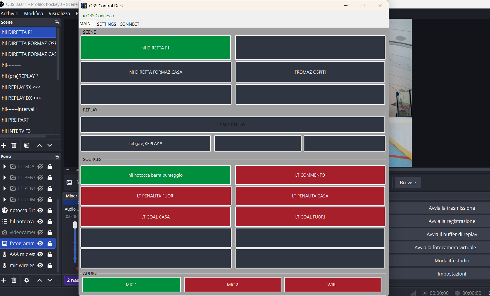
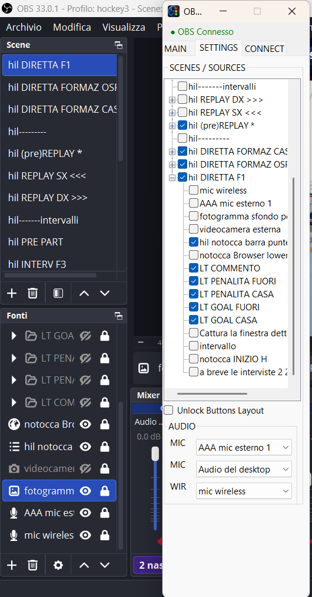
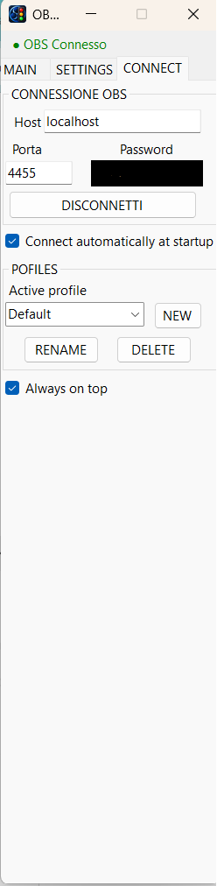

# Pokoto OBS Control Deck

A compact and customizable Windows control surface for OBS Studio.

Pokoto OBS Control Deck was originally created for my own live sports productions, where I wanted a small control surface that could stay next to OBS Studio and provide quick access to scenes, sources, audio and replay controls.

The application connects directly to OBS through OBS WebSocket and automatically reads the available scenes, sources and hotkeys.

(screenshots/main.png)

## Download

### [Download the latest version](https://github.com/pokoto-byte/pokoto-obs-control-deck/releases/latest)

Windows x64 • Self-contained • No installation required

Open the Latest Release and download:

`PokotoOBSControlDeck-vX.X.X.exe`

### Windows SmartScreen Notice

Pokoto OBS Control Deck is currently distributed as an unsigned application. Microsoft Defender SmartScreen may therefore show a "Windows protected your PC" message or report an unrecognized app. This can happen because the application is new and does not yet have an established publisher reputation.

If you downloaded Pokoto OBS Control Deck from the official GitHub repository:

1. Click **More info**.
2. Verify the executable name.
3. Click **Run anyway**.

There is no need to disable Microsoft Defender or SmartScreen.

For security, always download Pokoto OBS Control Deck from the official GitHub Releases page.

## Features

### Scenes

- Up to 9 configurable scene buttons
- Scenes selected directly from OBS
- Current Program Scene highlighted in green
- Drag & drop scene arrangement
- Optional OBS hotkeys on scene buttons
- Buttons can operate as:
  - Scene only
  - Scene + Hotkey
  - Hotkey only
- Custom button names with Rename / Reset
- Layout stored separately for each profile

### Dynamic Source Controls

- Up to 10 configurable source buttons for each OBS scene
- Source buttons automatically change according to the current Program Scene
- Green = source visible
- Red = source hidden
- Click to toggle source visibility
- Drag & drop source arrangement
- Custom source button names

Every OBS scene can therefore have its own dedicated source-control layout.

### Replay Buffer / Instant Replay

- Reads the real OBS Replay Buffer status
- SAVE REPLAY is available only while Replay Buffer is active
- Orange = ready
- SAVING... = replay saving
- Green SAVED = replay successfully saved
- HOTKEY ERROR = configured replay hotkey failed
- Optional OBS hotkey integration after replay saving
- Compatible with Instant Replay workflows based on OBS hotkeys

The specific behaviour of third-party OBS scripts depends on their own configuration.

### Audio

Three configurable OBS audio inputs can be controlled directly from MAIN.

- Click = Mute / Unmute
- Green = unmuted
- Red = muted
- State synchronized with OBS

### Profiles

Multiple profiles can be created. Each profile can store:

- Selected scenes
- Selected sources
- Scene layout
- Source layout
- Custom button names
- Scene hotkeys
- Replay hotkey
- Audio mappings
- OBS connection settings
- Auto Connect
- Always on Top

### Interface

- Compact design intended to stay beside OBS Studio
- Responsive MAIN panel
- Scene, Source, Replay and Audio controls grow when the window is resized
- Safe minimum window size prevents clipped controls
- Preferred window size remembered between sessions
- Optional Always on Top

MAIN expands with the window while keeping the operational layout.

## Requirements

- Windows
- OBS Studio
- OBS WebSocket enabled
- Local/network access to the OBS WebSocket server

OBS WebSocket is integrated into current OBS Studio versions.

## Getting Started

1. Start OBS Studio.
2. Enable OBS WebSocket.
3. Start Pokoto OBS Control Deck.
4. Open CONNECT.
5. Enter Host, Port and Password.
6. Connect to OBS.
7. Open SETTINGS.
8. Select the OBS scenes to use.
9. Expand scenes and select the sources to expose as dynamic controls.
10. Configure Audio inputs if required.

MAIN then becomes the operational control surface.

## Reordering Buttons

Enable **Unlock Function Layout** to turn on drag & drop.

Buttons can be swapped with each other or moved into empty slots.

Disable the option again for normal live operation.

Layouts are automatically stored in the active profile.

## Renaming Buttons

Right-click a button and choose:

- **Rename button...**
- **Reset name**

Custom names affect only Pokoto OBS Control Deck and do not rename the actual Scene or Source in OBS.

## OBS Hotkeys

Supported scene buttons can have OBS hotkeys assigned. Possible configurations:

- Scene
- Scene + Hotkey
- Hotkey only

The hotkey list is read from OBS.

Pokoto OBS Control Deck uses OBS WebSocket hotkey names and does **not** simulate physical keyboard presses.

## Replay / Instant Replay

SAVE REPLAY monitors the Replay Buffer status:

- If Replay Buffer is stopped, SAVE REPLAY is disabled.
- If Replay Buffer is active, SAVE REPLAY is enabled.

An optional OBS hotkey can be integrated into the replay workflow.

Replay and Instant Replay behaviour depends on your OBS configuration and scripts.

## Auto Connect

Auto Connect can reconnect to OBS automatically at application startup using the active profile.

## Always on Top

Always on Top can be enabled or disabled and is stored in the active profile.

## Local Configuration

User profiles and local configuration are stored outside the source/application project directory.

Personal OBS configurations, passwords and user profiles are **not** included in the GitHub repository.

## About

Pokoto OBS Control Deck

Version 1.0.0

Created by Pokoto.

It began as a tool for live hockey productions and evolved into a general OBS control surface.

## Development Note

Pokoto OBS Control Deck was developed as a personal project with AI-assisted development using Microsoft Copilot and GitHub Copilot.

The application was designed and tested around real live-production workflows.

## Support

Pokoto OBS Control Deck is free to use.

Links will be completed before or during the public release:

- GitHub repository: _to be added_
- OBS Forum discussion: _to be added_
- Optional donations/support: _to be added_

## Disclaimer

Pokoto OBS Control Deck is an independent community project.

It is not affiliated with, endorsed by, or sponsored by the OBS Project.

OBS and OBS Studio are trademarks of their respective owners.

## License

Pokoto OBS Control Deck is released under the MIT License.
